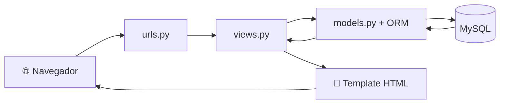

# 🛒 Mini Loja Virtual


> Projeto de estudo para aprender **desenvolvimento back end com Django**, construindo uma loja virtual do zero, passo a passo.

---

## 🎯 Objetivo do projeto

Este projeto não é um produto pronto: é o **caderno de estudos em forma de código** de quem está aprendendo a ser desenvolvedor back end. A ideia é aprender Django construindo algo real, em vez de só ler a teoria.

A cada etapa do aprendizado, um recurso novo entra na loja:

| Conceito estudado | Onde aparece na loja |
|---|---|
| Views | Páginas de lista, detalhe e contato |
| Templates | Layout base com herança e páginas reutilizáveis |
| Models e ORM | Tabela de produtos no MySQL |
| Migrations | Histórico de mudanças do banco |
| Variáveis de ambiente | Senha do banco fora do código (`.env`) |
| Django Admin | Painel para cadastrar e editar produtos |
| Forms e ModelForm | Formulário de contato e cadastro de produto, com validação |

---

## ✨ O que já funciona

- 📋 **Listagem de produtos**, lida direto do banco de dados
- 🔍 **Busca por nome** (sem diferenciar maiúsculas de minúsculas)
- 📄 **Página de detalhe** de cada produto, com erro 404 quando ele não existe
- 🛠️ **Painel administrativo** (Django Admin) para gerenciar os produtos
- ✉️ **Formulário de contato** com validação dos campos e mensagens de erro
- ➕ **Cadastro de produto pelo site**, feito com `ModelForm` e redirecionamento após salvar
- 🗄️ **Banco MySQL** conectado ao Django pelo ORM
- 🔐 **Credenciais protegidas** em arquivo `.env`, fora do GitHub

> ⚠️ A página de cadastro de produto pelo site existe como exercício de formulários e **ainda não exige login**. O cadastro "de verdade" é feito pelo Admin. A proteção chega com a etapa de autenticação.

---

## ⚙️ Como funciona

Quando alguém acessa uma página da loja, o pedido passa por estas etapas:



1. **O navegador** envia um pedido (por exemplo, `?q=camiseta` para buscar).
2. **`urls.py`** descobre qual view atende aquele endereço.
3. **`views.py`** executa a lógica e pede os dados ao banco.
4. **O ORM** traduz o código Python em SQL e conversa com o **MySQL**.
5. **O template** recebe os dados e monta a página em HTML.
6. **A resposta** volta ao navegador.

### E quando o usuário envia um formulário?

Nas páginas com formulário, a mesma view trata dois momentos:

1. **GET**: o usuário abre a página e recebe o formulário vazio.
2. **POST**: o usuário envia os dados e a view os entrega ao **Form**, que valida e converte cada campo.
3. **Dados válidos**: o `ModelForm` grava o produto no banco (`save()`) e a view redireciona para outra página, o que evita reenviar o formulário ao recarregar.
4. **Dados inválidos**: a página é exibida de novo com as mensagens de erro e o que o usuário já tinha digitado.

---

## 🧱 Tecnologias

- **Python**: linguagem do projeto
- **Django**: framework web (views, templates, ORM, admin, forms)
- **MySQL 8.4 LTS**: banco de dados
- **mysqlclient**: driver que conecta o Django ao MySQL
- **python-dotenv**: leitura das variáveis do arquivo `.env`

---

## 📁 Estrutura resumida

```text
django_project/
├── manage.py
├── django_project/        # configurações do projeto (settings.py, urls.py)
├── loja/                  # app da loja
│   ├── models.py          # modelo Produto
│   ├── views.py           # lógica das páginas
│   ├── urls.py            # rotas do app
│   ├── forms.py           # ContatoForm e ProdutoForm (ModelForm)
│   ├── admin.py           # configuração do painel administrativo
│   ├── migrations/        # histórico do banco
│   └── templates/         # páginas HTML
├── requirements.txt
├── .env                   # senhas (NÃO vai para o GitHub)
└── .gitignore
```

---

## 🚀 Como rodar o projeto

### Pré-requisitos

- Python instalado
- MySQL Server **8.4 ou superior** (o Django 6.1 exige essa versão)

### Passo a passo

**1. Clone o repositório e entre na pasta**

```bash
git clone <url-do-repositorio>
cd django_project
```

**2. Crie e ative o ambiente virtual**

```bash
python -m venv venv
venv\Scripts\activate
```

**3. Instale as dependências**

```bash
pip install -r requirements.txt
```

**4. Crie o banco no MySQL**

```sql
CREATE DATABASE loja_db;
```

**5. Crie o arquivo `.env`** na mesma pasta do `manage.py`:

```text
DB_NAME=loja_db
DB_USER=seu_usuario
DB_PASSWORD="sua_senha"
DB_HOST=127.0.0.1
DB_PORT=3306
```

> ⚠️ Nunca envie o `.env` para o GitHub. Ele já está no `.gitignore`.

**6. Crie as tabelas e o usuário administrador**

```bash
python manage.py migrate
python manage.py createsuperuser
```

**7. Inicie o servidor**

```bash
python manage.py runserver
```

Depois, abra `http://127.0.0.1:8000/` no navegador. O painel administrativo fica em `http://127.0.0.1:8000/admin/`.

---

## 🗺️ Roadmap de estudos

- [x] Views baseadas em função
- [x] Templates e herança
- [x] Models, migrations e ORM
- [x] Integração com MySQL
- [x] Variáveis de ambiente (`.env`)
- [x] Painel administrativo (Django Admin)
- [x] Formulários (`Form` e `ModelForm`)
- [ ] APIs REST com Django REST Framework 🚧 *(próxima etapa)*
- [ ] Autenticação e permissões
- [ ] Carrinho e pedidos
- [ ] Views baseadas em classe
- [ ] Arquivos estáticos e mídia
- [ ] Testes automatizados
- [ ] Deploy

---

## 📚 Referências

- [Roadmap de Django (roadmap.sh)](https://roadmap.sh/django)
- [Documentação oficial do Django](https://docs.djangoproject.com/)

---

## 👨‍💻 Autor

Feito por **Kauan** como parte da jornada para se tornar desenvolvedor back end.